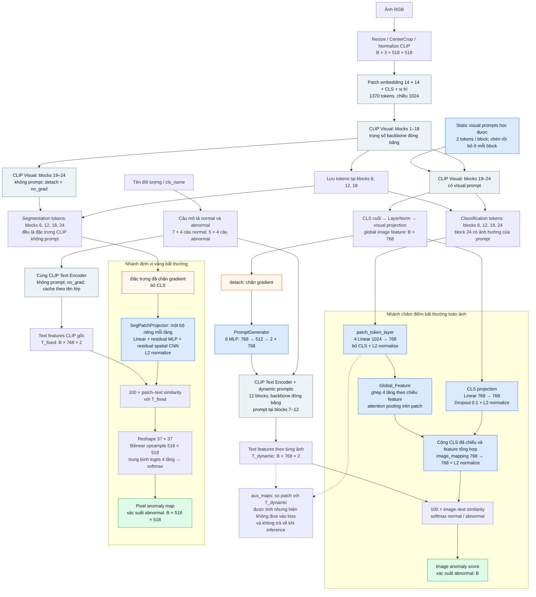
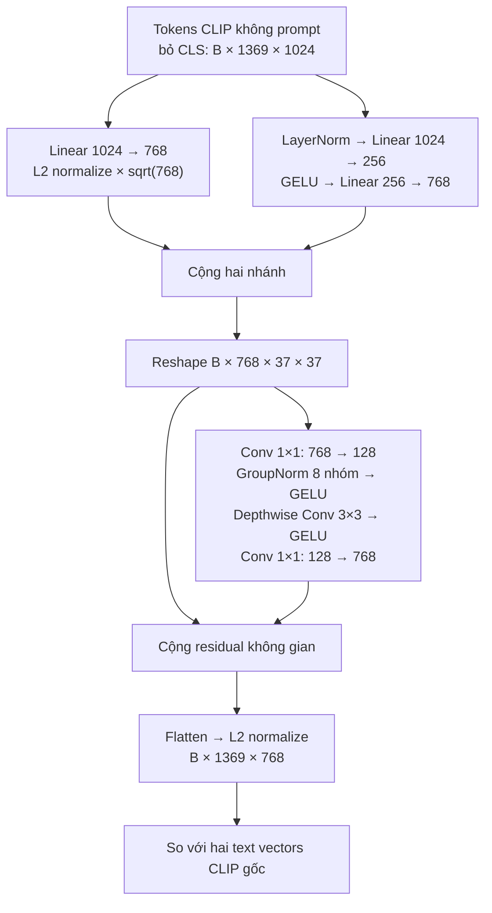
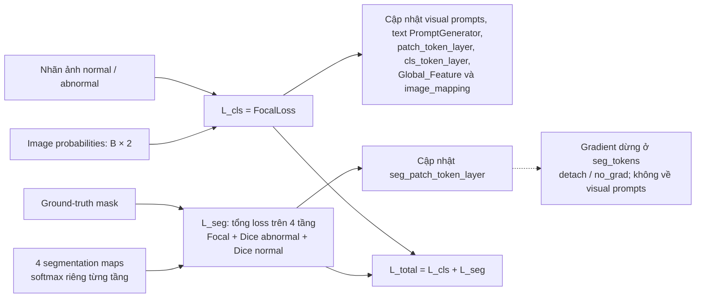
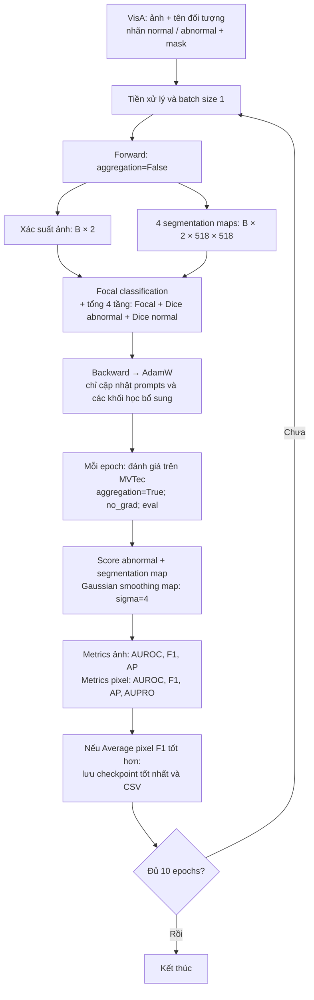

**Sơ đồ mô hình hiện tại**

Tài liệu mô tả code đang có trong `method/adaclip.py`, `method/fushion.py` và
`method/trainer.py`. Cấu hình minh họa lấy theo `train.sh` và giá trị mặc định
trong `train.py`: CLIP ViT-L/14-336, ảnh 518 × 518, hai nhánh prompt
`VL`, prompt length = 2, lấy feature ở block 6, 12, 18, 24.
Tên checkpoint và log cũ có thể phản ánh những phiên bản kiến trúc khác.

Mô hình trả lời hai câu hỏi: **ảnh có bất thường không?** bằng nhánh
classification, và **bất thường nằm ở đâu?** bằng nhánh segmentation.
CLIP giữ nguyên trọng số; các prompt và các khối xử lý bổ sung được học.

**1. Kiến trúc tổng thể**



Các đường CLIP trong sơ đồ dùng **cùng bộ trọng số đã đóng băng**. Visual
Encoder chạy chung blocks 1–18. Ngay trước block 19, code tạo
`x_frozen = x.detach()` rồi chạy tiếp blocks 19–24 theo hai đường: có prompt
cho classification và không prompt, trong `no_grad`, cho segmentation.
Với các tầng mặc định, tokens tại blocks 6, 12, 18 chung giá trị giữa hai
nhánh; tokens block 24 được lấy từ hai đường khác nhau.

Màu xám biểu thị trọng số CLIP đóng băng, xanh dương là thành phần học được,
cam là nơi chặn gradient, xanh lá là đầu ra. Khối CLIP có prompt vẫn truyền
gradient về prompt dù bản thân trọng số CLIP không được cập nhật.

**2. Vị trí chèn prompt**

Số block dưới đây đếm từ 1; các danh sách trong code dùng index từ 0.

| Thành phần | Blocks dùng prompt | Cách hoạt động |
| --- | --- | --- |
| Visual Encoder | 19–24, tương ứng index 18–23 | Mỗi block có visual prompt học được, dùng chung cho các ảnh. Chèn sau CLS trước khi chạy block; bỏ prompt tokens khỏi đầu ra block, giữ CLS và toàn bộ spatial patches. |
| Text Encoder cho classification | 7–12, tương ứng index 6–11 | Sinh prompt từ global image feature đã `detach`. Chèn sau SOT ở block 7 và thay prompt tại các block tiếp theo. |
| Text Encoder cho segmentation | Không chèn | Mã hóa câu normal / abnormal bằng CLIP gốc, không tính gradient và cache theo tên đối tượng. |

`PromptGenerator` có 6 MLP, mỗi MLP gồm:

```text
image feature đã detach: [B, 768]
  → Dropout(0.1)
  → Linear(768, 512)
  → GELU
  → Linear(512, 2 × 768)
  → reshape [B, 2, 768]
```

Text được tạo từ tên đối tượng: 7 trạng thái normal × 4 templates = 28 câu,
5 trạng thái abnormal × 4 templates = 20 câu. Cả hai cách mã hóa đều chạy
từng câu qua Text Encoder, lấy embedding EOT, chiếu sang không gian CLIP,
chuẩn hóa từng câu rồi lấy trung bình và chuẩn hóa theo trạng thái.
Đầu ra là hai vector theo thứ tự normal, abnormal.

Nhánh classification dùng dynamic prompts phụ thuộc global image feature
của từng ảnh. Nhánh segmentation dùng text không prompt và cache hai vector
theo tên đối tượng. Forward hiện tại không có bước early pooling, dù cấu
hình vẫn có `early_pool=True`.

**3. Kích thước tensor**

Kích thước dưới đây áp dụng cho ảnh 518 × 518 và cấu hình trên. `B` là batch
size; `N = (518 / 14)² = 1369` patches. Bốn tầng trích xuất có cùng độ phân
giải 37 × 37, khác nhau về độ sâu ngữ nghĩa.

| Tensor / khối | Kích thước |
| --- | --- |
| Ảnh vào | `[B, 3, 518, 518]` |
| Tokens trích từ mỗi visual block | `[B, 1370, 1024]`, gồm 1 CLS và 1369 patches |
| Global image feature sau visual projection gốc | `[B, 768]` |
| Patch features sau mỗi projection head | `[B, 1369, 768]` |
| Text features, thứ tự normal rồi abnormal | `[B, 768, 2]` |
| Ghép 4 tầng trong `Global_Feature` | `[B, 1369, 3072]` |
| Linear đầu trong `Global_Feature` | `[B, 1369, 512]` |
| Attention weights theo vị trí patch | `[B, 1369, 1]`, softmax theo 1369 patches |
| Tổng có trọng số → Linear → L2 normalize | `[B, 512] → [B, 768]` |
| Logits patch–text mỗi tầng | `[B, 1369, 2]` |
| Map mỗi tầng sau nội suy | `[B, 2, 518, 518]` |
| Classification khi train / test | `[B, 2]` / `[B]` |
| Segmentation khi train / test | Danh sách 4 maps `[B, 2, 518, 518]` / một map `[B, 518, 518]` |

**4. Bộ chiếu segmentation và cách tạo hai đầu ra**

[Xem sơ đồ chi tiết từng phép toán của SegPatchProjector](seg_patch_projector.md).

`SegPatchProjector` có một bộ tham số riêng cho mỗi tầng trích xuất:



MLP học biến đổi phi tuyến trên mỗi patch; CNN trao đổi thông tin giữa các
patch lân cận trên lưới 37 × 37. Linear/Conv cuối của hai nhánh residual
được khởi tạo bằng 0, nên lúc khởi tạo đầu ra trước chuẩn hóa tương ứng với
nhánh Linear đã chuẩn hóa và nhân `sqrt(768)`.

Gọi `norm` là chuẩn hóa L2 ở chiều embedding, `g` là global image feature,
`P_l` là classification patch tokens đã bỏ CLS, `Q_l` là segmentation patch
tokens CLIP không prompt đã bỏ CLS; `W_l` là Linear và `S_l` là
`SegPatchProjector` của tầng tương ứng.

```text
P_cls_l = norm(W_l(P_l))
c       = norm(Dropout(W_cls(g)))
f       = norm(image_mapping(c + Global_Feature({P_cls_l})))
score   = softmax(100 × fᵀ × T_dynamic)[abnormal]

P_seg_l = norm(S_l(Q_l))        # Q_l đã detach / no_grad
logit_l = upsample(reshape(100 × P_seg_l × T_fixed))
map     = softmax(mean_l(logit_l), dim=normal_abnormal)[abnormal]
```

Trong code, map cuối được viết là `(p_abnormal + 1 - p_normal) / 2`.
Với softmax hai lớp, biểu thức này tương đương `p_abnormal`.
Khi đánh giá dataset, `evaluation()` còn làm mượt map bằng Gaussian filter
với `sigma=4` sau khi chuyển sang NumPy; bước này nằm ngoài `Baseline.forward()`.

Trong `Global_Feature`, bốn patch features được ghép theo chiều embedding
thành `[B, 1369, 3072]`, chiếu xuống 512 chiều. Một Linear tạo điểm attention
cho mỗi patch; softmax theo vị trí patch tạo trọng số để lấy tổng có trọng số.
Kết quả được chiếu lên 768 chiều và chuẩn hóa, rồi cộng với CLS đã chiếu.
Image score được tính từ feature tổng hợp này và text động; không lấy
max hay trung bình từ segmentation map.

**5. Loss và đường truyền gradient**



CLIP backbone đóng băng nhưng các phép tính của nó vẫn có thể truyền gradient
về prompt tokens. `detach` ở đầu vào PromptGenerator chỉ chặn gradient đi về
image feature qua đường điều kiện; PromptGenerator vẫn được học từ `L_cls`.

`seg_patch_token_layer` được liệt kê rõ trong các tham số học được. Tất cả
thành phần học được dùng chung một AdamW, learning rate theo `train.sh` là
`0.0001`, betas `(0.5, 0.999)`, weight decay `0.01`.

**6. Luồng huấn luyện và đánh giá theo train.sh**



Khi train, softmax riêng từng tầng để tính loss cho cả bốn segmentation maps.
Khi đánh giá, lấy trung bình logits bốn tầng rồi mới softmax để trả một map.
`Baseline.forward()` trả map và score liên tục; không áp dụng ngưỡng để tạo
mask nhị phân hoặc nhãn nhị phân ở đây.

Dữ liệu nguồn được học có giám sát bằng nhãn ảnh và mask. Trong
`BaseDataset`, cả chế độ training lẫn testing đều đọc phần `meta_info['test']`
của dataset tương ứng. Với `train.sh`, đó là phần test của VisA để học và
phần test của MVTec để đánh giá, chọn checkpoint. MVTec không tham gia
backpropagation, nhưng pixel F1 trên MVTec được dùng để chọn checkpoint.

**7. Các chi tiết cần giữ đúng khi trình bày**

- `Global_Feature` hiện thực ghép feature đa tầng và attention pooling trên
  patches. Forward hiện tại không chạy K-means hay phân cụm K=20; `use_hsf`
  và `k_clusters` được lưu trong `Baseline` nhưng không điều khiển luồng tính.
- `prompting_depth=4` và `prompting_type='SD'` vẫn xuất hiện trong cấu hình,
  nhưng vị trí prompt thực tế được cố định bằng hai danh sách 6 blocks trong
  `PromptLayer`. Visual dùng static prompts; text dùng image-conditioned prompts.
- `text_prompts` được khai báo nhưng không được dùng để tạo text prompt trong
  forward hiện tại. Các tham số được liệt kê trong optimizer nhưng không tham
  gia forward sẽ không nhận gradient. Sơ đồ thể hiện các thành phần có sử dụng.
- `aux_maps` dùng classification patch features và dynamic text features.
  Chúng được tính, nhưng `seg_l(aux_maps)` đang bị comment trong trainer.
- `anomaly_config` được truyền vào trainer nhưng chưa được dùng để xây dựng
  mô hình. `seg_text_mode='prompted'` trong cấu hình không đổi việc nhánh
  segmentation dùng `TextEncoder(fixed=True, use_prompt=False)`. Tương tự,
  `early_pool` và `prompt_temperature` không điều khiển forward hiện tại;
  hệ số similarity thực tế được viết cố định là `100.0`.
- `extract_feat()` còn gọi thêm `self.visual(image, ...)` trong `no_grad`,
  nhưng hai kết quả `frozen_cls`, `frozen_patch` không được dùng. Tokens thực
  sự cấp cho segmentation đến từ `seg_tokens` trong `encode_image()`, như
  sơ đồ. Lượt chạy thêm này vẫn được thực thi nhưng không đóng góp đầu ra.

**8. Đối chiếu mã nguồn**

- [Baseline, feature extraction và hai nhánh đầu ra](../method/adaclip.py)
- [PromptLayer, PromptGenerator, TextEncoder, projection và fusion](../method/fushion.py)
- [Đóng băng tham số, optimizer, loss và evaluation](../method/trainer.py)
- [Cấu hình backbone ViT-L/14-336](../model_configs/ViT-L-14-336.json)
- [Thiết lập train](../train.sh) và [vòng lặp huấn luyện](../train.py)
- [Nguồn dữ liệu và cách đọc nhãn / mask](../dataset/base_dataset.py)
