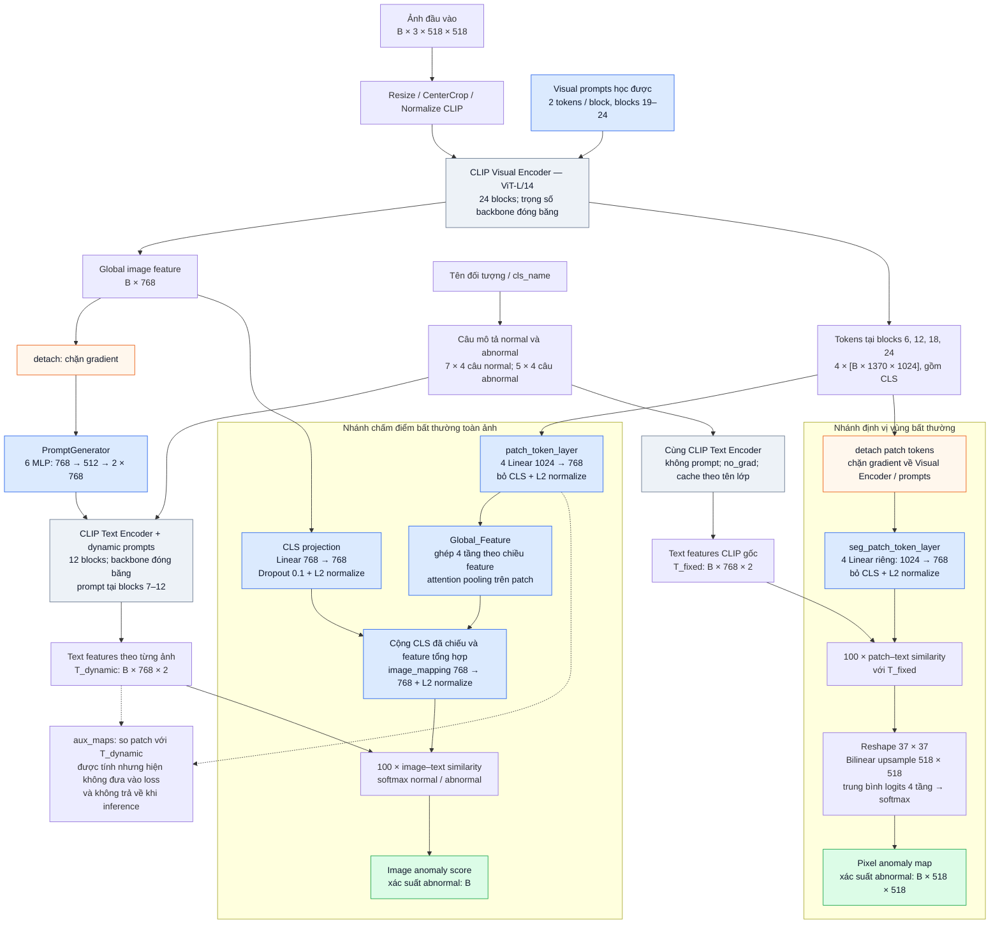
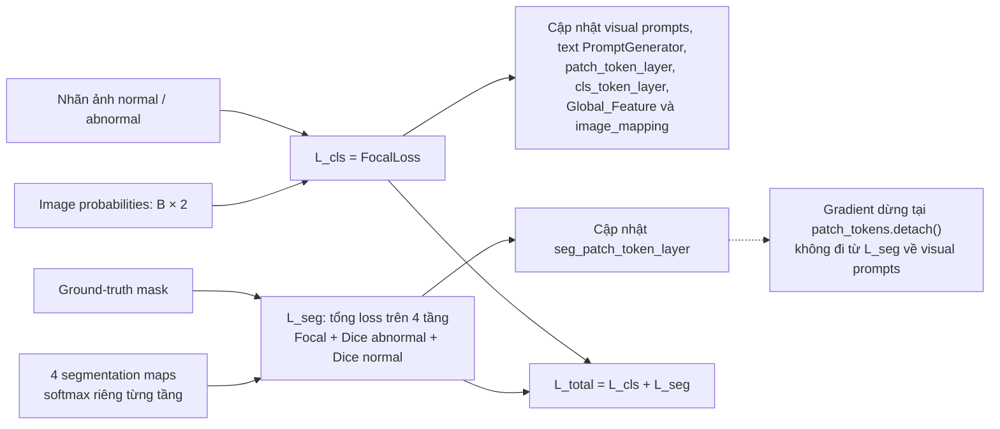

# Sơ đồ mô hình hiện tại

Tài liệu mô tả code đang có trong `method/adaclip.py`, `method/fushion.py` và
`method/trainer.py`. Cấu hình minh họa lấy theo `train.sh` và giá trị mặc định
trong `train.py` / `test.py`: CLIP ViT-L/14-336, ảnh 518 × 518, hai nhánh prompt
`VL`, prompt length = 2, lấy feature ở block 6, 12, 18, 24.
Tên checkpoint và log cũ có thể phản ánh những phiên bản kiến trúc khác.

## 1. Kiến trúc tổng thể



Hai khối Text Encoder trong sơ đồ biểu diễn hai cách gọi **cùng bộ trọng số
CLIP**, không phải hai backbone độc lập. Nhánh segmentation cũng lấy tokens
từ **lượt chạy Visual Encoder có prompt** ở phía trên.

## 2. Vị trí chèn prompt

Số block dưới đây đếm từ 1; các danh sách trong code dùng index từ 0.

| Thành phần | Blocks dùng prompt | Cách hoạt động |
| --- | --- | --- |
| Visual Encoder | 19–24, tương ứng index 18–23 | Mỗi block có visual prompt học được, dùng chung cho các ảnh. Chèn sau CLS trước khi chạy block; bỏ prompt tokens khỏi đầu ra block, giữ CLS và toàn bộ spatial patches. |
| Text Encoder cho classification | 7–12, tương ứng index 6–11 | Sinh prompt từ global image feature đã `detach`. Chèn sau SOT ở block 7 và thay prompt tại các block tiếp theo. |
| Text Encoder cho segmentation | Không chèn | Mã hóa câu normal / abnormal bằng CLIP gốc, không tính gradient và cache theo tên đối tượng. |

`PromptGenerator` có 6 MLP, mỗi MLP gồm:

```text
image feature đã detach: [B, 768]
  → Dropout(0.1)
  → Linear(768, 512)
  → GELU
  → Linear(512, 2 × 768)
  → reshape [B, 2, 768]
```

Text được xử lý theo từng ảnh và từng trạng thái normal / abnormal. Với nhánh
có prompt, code lấy trung bình hidden states của các câu cùng trạng thái ngay
trước block 7 (`early_pool=True`), rồi tiếp tục qua các block có prompt.
Đầu ra EOT được chiếu sang không gian CLIP, chuẩn hóa và tổng hợp thành hai
text features. Nhánh text không prompt tổng hợp các câu sau khi mã hóa.

## 3. Kích thước tensor

Kích thước dưới đây áp dụng cho ảnh 518 × 518 và cấu hình trên. `B` là batch
size; `N = (518 / 14)² = 1369` patches. Bốn tầng trích xuất có cùng độ phân
giải 37 × 37, khác nhau về độ sâu ngữ nghĩa.

| Tensor / khối | Kích thước |
| --- | --- |
| Ảnh vào | `[B, 3, 518, 518]` |
| Tokens trích từ mỗi visual block | `[B, 1370, 1024]`, gồm 1 CLS và 1369 patches |
| Global image feature sau visual projection gốc | `[B, 768]` |
| Patch features sau mỗi projection head | `[B, 1369, 768]` |
| Text features, thứ tự normal rồi abnormal | `[B, 768, 2]` |
| Ghép 4 tầng trong `Global_Feature` | `[B, 1369, 3072]` |
| Linear đầu trong `Global_Feature` | `[B, 1369, 512]` |
| Attention weights theo vị trí patch | `[B, 1369, 1]`, softmax theo 1369 patches |
| Tổng có trọng số → Linear → L2 normalize | `[B, 512] → [B, 768]` |
| Logits patch–text mỗi tầng | `[B, 1369, 2]` |
| Map mỗi tầng sau nội suy | `[B, 2, 518, 518]` |
| Classification khi train / test | `[B, 2]` / `[B]` |
| Segmentation khi train / test | Danh sách 4 maps `[B, 2, 518, 518]` / một map `[B, 518, 518]` |

## 4. Cách tạo hai đầu ra

Gọi `norm` là chuẩn hóa L2 ở chiều embedding, `g` là global image feature,
`P_l` là patch tokens đã bỏ CLS và `W_l`, `S_l` là hai bộ projection riêng.

```text
P_cls_l = norm(W_l(P_l))
c       = norm(Dropout(W_cls(g)))
f       = norm(image_mapping(c + Global_Feature({P_cls_l})))
score   = softmax(100 × fᵀ × T_dynamic)[abnormal]

P_seg_l = norm(S_l(detach(P_l)))
logit_l = upsample(reshape(100 × P_seg_l × T_fixed))
map     = softmax(mean_l(logit_l), dim=normal_abnormal)[abnormal]
```

Trong code, map cuối được viết là `(p_abnormal + 1 - p_normal) / 2`.
Với softmax hai lớp, biểu thức này tương đương `p_abnormal`.
Khi đánh giá dataset, `evaluation()` còn làm mượt map bằng Gaussian filter
với `sigma=4` sau khi chuyển sang NumPy; bước này nằm ngoài `Baseline.forward()`.

## 5. Loss và đường truyền gradient



CLIP backbone đóng băng nhưng các phép tính của nó vẫn có thể truyền gradient
về prompt tokens. `detach` ở đầu vào PromptGenerator chỉ chặn gradient đi về
image feature qua đường điều kiện; PromptGenerator vẫn được học từ `L_cls`.

`seg_patch_token_layer` được đưa vào optimizer và checkpoint vì phép kiểm tra
tên dùng substring: `'patch_token_layer' in 'seg_patch_token_layer...'` là đúng.
Nhánh này có learning rate riêng là `0.001`.

## 6. Các chi tiết cần giữ đúng khi trình bày

- `Global_Feature` hiện thực ghép feature đa tầng và attention pooling trên
  patches. Forward hiện tại không chạy K-means hay phân cụm K=20; `use_hsf`
  và `k_clusters` được lưu trong `Baseline` nhưng không điều khiển luồng tính.
- `prompting_depth=4` và `prompting_type='SD'` vẫn xuất hiện trong cấu hình,
  nhưng vị trí prompt thực tế được cố định bằng hai danh sách 6 blocks trong
  `PromptLayer`. Visual dùng static prompts; text dùng image-conditioned prompts.
- `text_prompts` được khai báo nhưng không được dùng để tạo text prompt trong
  forward hiện tại. Sơ đồ chỉ thể hiện các tham số thực sự tham gia tính toán.
- `aux_maps` dùng classification patch features và dynamic text features.
  Chúng được tính, nhưng `seg_l(aux_maps)` đang bị comment trong trainer.
- `anomaly_config` được truyền vào trainer nhưng chưa được dùng để xây dựng
  mô hình. Các cơ chế tail / ranking / self-reference trong log cũ không có
  trong forward hiện tại.

## 7. Đối chiếu mã nguồn

- [Baseline, feature extraction và hai nhánh đầu ra](../method/adaclip.py)
- [PromptLayer, PromptGenerator, TextEncoder, projection và fusion](../method/fushion.py)
- [Đóng băng tham số, optimizer, loss và evaluation](../method/trainer.py)
- [Cấu hình backbone ViT-L/14-336](../model_configs/ViT-L-14-336.json)
- [Thiết lập train](../train.sh) và [thiết lập test](../test.py)
