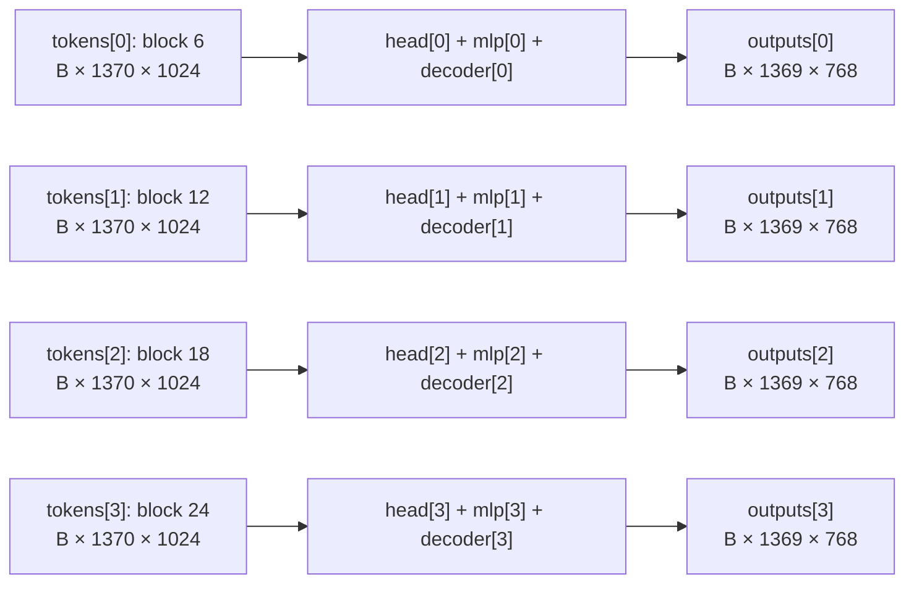
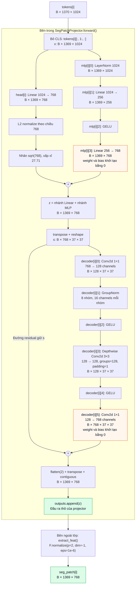

**SegPatchProjector: sơ đồ chi tiết theo mã nguồn**

[Mở sơ đồ SVG để phóng to](seg_patch_projector.svg) hoặc
[xem ảnh PNG](seg_patch_projector.png). Đối chiếu với
[SegPatchProjector](../method/fushion.py#L259),
[cấu hình khởi tạo](../method/adaclip.py#L68) và
[chuẩn hóa sau projector](../method/adaclip.py#L260).

Với cấu hình ViT-L/14, ảnh 518 × 518: `input_dim=1024`, `output_dim=768`,
`hidden_dim=256`, `conv_dim=128`, `use_spatial=True`. Có 1369 patches trên
lưới 37 × 37 và một CLS token. `B` là batch size, bằng 1 trong `train.sh`.

**1. Một bộ tham số riêng cho mỗi tầng trích xuất**



Bốn bộ có cùng kiến trúc nhưng không chia sẻ tham số. Code xử lý chúng
trong vòng lặp `for i in range(self.num_replicas)`, không ghép hoặc lấy
trung bình bốn tầng bên trong projector. Đầu ra là danh sách bốn tensors.
Đầu vào `seg_tokens` là đặc trưng CLIP không prompt, đã chặn gradient về
backbone. Trước khi gọi projector, `extract_feat()` chuyển tensors sang
FP32 và tắt autocast cho khối tính toán này.


**2. Bên trong một bộ, với tầng trích xuất i**



Hai phép cộng đều cộng từng phần tử. Nhánh MLP nhận trực tiếp `x` sau khi
bỏ CLS, không nhận đầu ra của `head[i]`. Nhánh CNN nhận feature đã cộng
Linear và MLP; đường residual không gian giữ nguyên feature này.

**3. Các phép toán tương ứng**

Với một tầng i, gọi `norm` là chuẩn hóa L2 theo chiều embedding:

```text
x = tokens[i][:, 1:, :]                      # [B, 1369, 1024]
h = sqrt(768) * norm(head[i](x))             # [B, 1369, 768]
m = Linear_256_to_768(GELU(
        Linear_1024_to_256(LayerNorm(x))))   # [B, 1369, 768]
z = h + m

s = reshape_to_grid(z)                      # [B, 768, 37, 37]
d = Conv1x1_128_to_768(GELU(
        DepthwiseConv3x3(GELU(
            GroupNorm(Conv1x1_768_to_128(s))))))
o = flatten_to_tokens(s + d)                # [B, 1369, 768]

# Ngoài SegPatchProjector, trong extract_feat():
seg_patch[i] = norm(o)                      # [B, 1369, 768]
```

| Thành phần | Vai trò |
| --- | --- |
| Linear 1024 → 768 | Đưa visual features về cùng số chiều với CLIP text features. |
| L2 normalize × sqrt(768) | Đặt độ dài vector ở nhánh Linear xấp xỉ 27.71 trước khi cộng residual, với vector khác 0. |
| MLP 1024 → 256 → 768 | Học biến đổi phi tuyến theo từng patch; không trộn các vị trí patch. |
| Conv 1×1 đầu | Trộn channels và giảm chiều từ 768 xuống 128 tại từng vị trí. |
| GroupNorm, GELU | Chuẩn hóa theo nhóm channels và thêm phép biến đổi phi tuyến. |
| Depthwise Conv 3×3 | Kết hợp các vị trí lân cận 3×3 riêng trên từng channel. |
| Conv 1×1 cuối | Trộn channels và đưa về 768 chiều để cộng được với đường residual. |
| L2 normalize bên ngoài | Chuẩn hóa embedding patch trước khi tính độ tương đồng với text. |

Spatial CNN giữ nguyên lưới 37 × 37: Conv 1×1 có stride mặc định bằng 1;
Depthwise Conv 3×3 có stride 1, padding 1. Projector không upsample ảnh.
Nếu số patches không tạo được lưới vuông, code báo `ValueError`.

**4. Khởi tạo và đường gradient**

Linear cuối của MLP và Conv cuối của CNN đều có weight, bias khởi tạo bằng
0. Vì thế, ngay khi khởi tạo, `m=0` và `d=0`; đầu ra thô chỉ còn nhánh
`sqrt(768) * norm(head[i](x))`. Sau chuẩn hóa L2 bên ngoài, đầu ra tương ứng
với `norm(head[i](x))`, với vector khác 0. Hai nhánh residual có thể đóng
góp dần khi học.

Segmentation loss truyền gradient qua độ tương đồng patch–text, chuẩn hóa
L2 bên ngoài, rồi vào `head[i]`, `mlp[i]`, `decoder[i]`. Gradient dừng ở đầu
vào `seg_tokens`, do các tokens này đã được lấy bằng detach / no_grad.

**5. Từ embedding đến segmentation map**

```text
seg_patch[i]: [B, 1369, 768]
  × seg_text: [B, 768, 2]        # normal, abnormal; CLIP text không prompt
  × 100
  → logits [B, 1369, 2]
  → reshape [B, 2, 37, 37]
  → bilinear upsample [B, 2, 518, 518]
```

Khi train, softmax riêng mỗi tầng rồi tính Focal + Dice abnormal + Dice
normal. Khi inference, trung bình logits bốn tầng rồi mới softmax và lấy
xác suất abnormal. Các bước so khớp text, upsample và tổng hợp tầng nằm
trong `patch_text_maps()`, ngoài `SegPatchProjector`.
